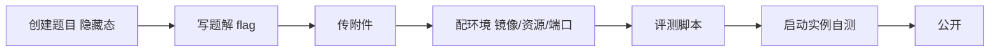

本页描述**纯面板操作**的上题全流程——从创建题目到选手可见，不涉及 kubectl 或服务器命令行。

前置条件：你是目标比赛的管理员，比赛处于**隐藏**或已创建状态。

## 流程总览

## 1. 创建题目

进入比赛 → 顶部 **题目** 标签页 → 工具栏 **创建** 按钮（仅比赛管理员可见）→ 填写表单：

| 字段 | 说明 |
| --- | --- |
| **名称** | 题目名，必填 |
| **标签** | 斜杠分隔的多级标签，如 `Web/SQL 注入`；第一级为主标签，用于题目列表分组 |
| **分值规则** | 动态计分三参数：**初始分值**（initial）、**最低分值**（minimum）、**衰减值**（decay，每次一血后按衰减下降） |
| **计分时段** | 可选；绑定[时间线预设](/ret2shell-docs/admin/games/)后，实现"练习周目不计分、正式周目计分" |
| **题目描述** | Markdown 题面，选手可见 |

创建后题目处于**隐藏**状态（列表中显示灰色关闭眼睛图标），选手不可见，管理员可自由修改。

## 2. 题解（答案）

点开题目，切换到 **题解** 标签 → **编辑** → 写入 flag/答案与解题思路 → 保存。

题解仅比赛管理员可见；`checker` 判题时与选手提交比对的就是这里的答案（动态 flag 场景下由评测脚本生成比对规则）。

## 3. 附件

**附件** 标签页，三类文件的可见性不同：

| 类型 | 选手可见 | 用途 |
| --- | --- | --- |
| **静态附件** | ✅ 原样提供 | 常规下发文件（ELF、pcap、源码包） |
| **动态附件** | ✅ 按选手哈希映射分发其中之一 | 需要人手一份的附件；多文件请打进压缩包 |
| **评测文件** | ❌ 永不下发 | checker 使用的字典、比对脚本等 |

在对应分区点 **上传**，选择本地文件，进度条走完即生效；可随时删除。

## 4. 配置环境（实例标签页）

**实例** 标签页同时承担"环境定义"与"实例管理"。

### 添加镜像

点 **添加镜像**：镜像会被自动拉取到服务器。两个来源：

1. **从游戏镜像仓库选择**：下拉检索本场游戏的镜像仓库（`useRegistryRepositories`），选中后列出全部 tag 可选；
2. **上传镜像**：点上传按钮，直接上传本地镜像 tar 包到 `POST /game/:id/registry`，上传完成后再从仓库中选择。

:::note[镜像推送的替代路径]
也可以在本机 `docker save` + `docker push` 到游戏仓库——但**面板上传不依赖本地 docker 权限**，是平台提供的官方路径。
:::

### 环境表单字段

| 字段 | 说明 |
| --- | --- |
| **容器名称** | 3-40 位，小写字母开头，仅含小写字母/数字/连字符，不能以连字符结尾 |
| **镜像标签 / 镜像版本** | 从仓库选择或手填 tag |
| **服务描述** | 开放端口时必填，展示给选手的服务说明 |
| **传输协议** | `TCP` / `STCP` / `UDP`。注意：UDP 不支持平台代理与 WSRX 访问（端口转发层限制），需自行配流量脚本 |
| **应用协议** | `原始` / `HTTP`（HTTP 会走反代链路） |
| **服务端口** | 1-65535，题目内监听端口，与其他服务的端口不能冲突 |
| **CPU 限制 / 内存限制 / 存储限制** | 上限值；默认 0.5 核 / 128Mi / 1024Mi |
| **资源请求**（cpu_req / mem_req / storage_req） | 调度保证值；默认 0.01 核 / 32Mi / 64Mi |
| **出网开关** `internet` | 该题容器是否允许访问外网（默认关，配合集群 NetworkPolicy） |
| **限制模式** `restricted` | 更细粒度的网络限制标记 |

一个题目可定义多个镜像/服务（多容器题目）。

### 环境路由与生命周期预设

镜像列表下方的 **出网开关** 与 **限制模式** 决定实例网络基线；比赛级出口拓扑在 **环境路由** 页配置（预设脚本 `single_node_direct` / `multi_node_direct`，见[环境路由与生命周期](/ret2shell-docs/admin/runtime/)）。

## 5. 评测（checker）

**评测** 标签页配置判题脚本：

- **脚本**：判定选手提交是否正确的脚本逻辑，动态 flag 场景按"每用户确定性 flag"生成后比对；
- **预设**：常用 checker 模板可直接套用后微调。

## 6. 启动实例自测

环境配好后，在 **实例** 标签页操作：

| 按钮 | 作用 |
| --- | --- |
| **启动！** | 拉起一个实例供测试 |
| **复制题目环境地址** | 复制实例连接地址（按传输协议：直连地址 / wsrx 中转链接） |
| **延长一小时** | TTL 续期，防止测试实例被自动回收 |
| **停止环境** | 立即回收实例 |

自测清单：连上端口能通、动态 flag 正常生成、checker 判对/判错都正确、附件能下载、内存/CPU 限制内稳定运行。

## 7. 公开上线

题目头部点 **公开**（绿色双上箭头按钮），确认提示：

> 公开后选手即可在开赛并进入相应周目之后阅览并解题。**公开期间无法修改题目**。

关键规则：

- **自动放题**按时间节点计算选手可见性，**不会更改公开状态**——所以**开赛前请把所有题目都置为公开**，放题时机交给计分时段/时间线控制；
- 需要改题时点 **隐藏**（黄色双下箭头），改完再公开；
- 隐藏状态的题目在选手列表里带关闭眼睛图标，仅管理员可见。

## 批量上题：题目仓库（Git）

比赛处于**隐藏**状态时，**题目仓库** 页面（`/games/:id/admin/git`）提供比赛数据仓库的克隆链接（用平台账户认证）。工作流：

1. 克隆仓库到本地；
2. 按既有题目目录结构添加题目与配置；
3. push 后平台**自动执行数据库同步与可用性检查**，等同步完成即可在面板看到新题。

:::caution[只读保护]
比赛对选手可见后仓库转为**只读**（禁止 push 与合并分支），防止绕过面板直接改动线上比赛数据。比赛数据结构属于内部格式，直接操作有损坏风险，常规上题推荐用面板流程。
:::
