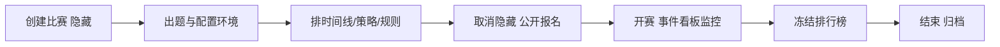

从首页 **比赛** 页面点击 **创建**，或直接访问 `/games/create`，填写表单即可创建比赛。创建者自动成为该比赛的管理员。

## 创建/编辑信息表单

创建后随时在比赛管理 **编辑信息**（`/games/:id/admin/edit`）修改，字段与创建时一致：

| 字段 | 说明 |
| --- | --- |
| **名称** `name` | 比赛名，必填 |
| **简介** `brief` | 一句话介绍，列表页展示 |
| **报名时间** `registerAt` | 开放报名的时间区间 |
| **开始时间** `startAt` / **结束时间** `endAt` | 比赛进行区间，必填 |
| **归档时间** `archiveAt` | 过时归档，之后可从列表折叠 |
| **权重** `weight` | 积分权重（影响跨赛积分展示） |
| **获奖率** `awardRate` | 一血/二血/三血与获奖比例 |
| **组队人数** `teamSize` | 每队上限 |
| **隐藏** `hidden` | 开启后比赛不出现在公开列表（备赛期用） |
| **冻结** `frozen` | 比赛期间冻结排行榜（最后一小时常用） |
| **线下** `offline` | 标记为线下赛 |
| **开赛后可报名** `canRegisterAfterStart` | 是否允许开赛后继续报名 |
| **队伍审核** `enableTeamAudit` | 队伍需管理员审核通过才能参赛 |
| **详细介绍** `introduction` | Markdown 长介绍 |
| **锤子反馈** `enableHammer` + 外链 | 开启"锤子"申诉工单；可配置外部锤子 URL |

:::tip[备赛工作流]
建赛时勾选 **隐藏**，此时比赛不可见、但全部管理功能可用——出题、配环境、排时间线都在隐藏状态下完成，赛前取消隐藏即可。
:::

## 时间线与自动放题

**时段管理**（`/games/:id/admin/timeline`）定义比赛的多个时段（如"练习周目""正式周目"），每个时段含 `start_at` / `end_at` / `label`，可保存为**预设**（timeline presets）。

时间线有两处消费方：

1. **自动放题**：题目的"计分时段"可选时间线预设；选手能否看到并解题由时段节点计算（详见[上题指南](/ret2shell-docs/admin/challenges/)）。
2. **生命周期与状态提示**：事件看板、统计按时段区分数据。

## 策略、规则与组织

- **比赛规则**（rules）：面向选手的规则页文本，Markdown。
- **策略管理**（policies）：提交频率、队伍策略等限制项表单。
- **组织管理**（organize）：主办/协办单位信息，含院校展示开关（配合院校数据用于高校联赛榜单）。
- **参赛队伍**（teams）：审核报名队伍、查看成员、解散违规队伍。
- **事件推送**（events）：绑定推送设备/Webhook 接收比赛事件，token 可重生成（重生成后旧 token 失效）。
- **锤子反馈**（hammers）：选手申诉工单的接收与回复。

## 监控与统计

- **事件看板**（monitor）：提交、审计事件的实时流，支持自动刷新，是赛中监控的主界面。
- **统计数据**（statistics）：做题数、得分分布、队伍进度。

## 删除比赛

`/games/:id/admin/delete`，输入确认后执行。删除不可恢复；如仅想下架，用 **隐藏** 开关替代。

