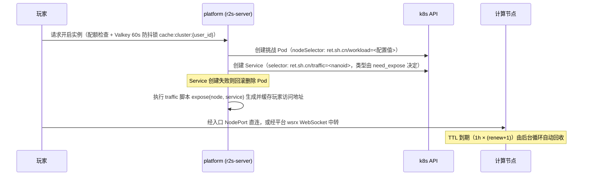

import { Aside } from '@astrojs/starlight/components';

核心实现位于 `crates/cluster/src/manager.rs` 与 `crates/server/src/routes/game/challenge/instance.rs`。

## 1. 生命周期时序

## 2. 调度标签（nodeSelector）

<Aside type="caution">
**只填标签值，不填键名。** 平台配置的 `nodeSelector` 不是完整键值对：创建 Pod 时平台固定拼接为 `ret.sh.cn/workload=<你填的值>`（`manager.rs` 硬编码键名，等值匹配，不支持 affinity / tolerations）。在 Admin 面板、values 或 API 设置时**必须只填 `challenge`**——填入 `ret.sh.cn/workload=challenge` 会拼接成含 `=` 的非法标签值，被 k8s 拒绝并返回 422。详见[踩坑手册 · 坑 13](/ops/troubleshooting/坑-13--node-selector-要填标签值不是键值对)。
</Aside>

**生效优先级**（`instance.rs`）：

1. **比赛未归档**：优先使用比赛级 `game.node_selector`；为空则回退到全局默认；两者都为空则不加 `nodeSelector`（可调度至任意可调度节点）。
2. **比赛已归档**：仅使用全局默认配置。
3. 运行时配置（Admin 面板 / 数据库）优先于 `config.toml` 的 `[cluster] node_selector`。

**修改入口**：

- 全局默认：`PATCH /api/cluster/node-selector`（DevOps 权限，对应 Admin 面板集群配置）
- 单场比赛：`PATCH /api/game/{id}/node-selector`

<Aside type="note">
**为什么用标签而不给控制面打 taint**：控制面节点不打 `ret.sh.cn/workload=challenge`，题目天然不会调度过去；平台自身六件套不设 selector，依靠 PV 的 `nodeAffinity` 固定。新节点只需 `kubectl label node <名> ret.sh.cn/workload=challenge` 即可加入计算池。
</Aside>

## 3. Pod 与 Service 构造细节

`create_challenge_env`（`manager.rs`）生成的对象属性：

| 属性 | 生成规则与默认值 |
| --- | --- |
| **Pod 名称** | `ret2shell-{challenge_id}-{user_id}-{unix_ts}` |
| **Pod 标签** | `ret.sh.cn/challenge`、`team`、`game`、`user`、`traffic`（21 位 nanoid）、`internet`（`"true"`/`"false"`） |
| **Pod 注解** | `ret.sh.cn/renew="0"`、`ret.sh.cn/ports` |
| **容器** | 每个 `ChallengeImage` 对应一个 Container；`imagePullPolicy: Always` |
| **容器端口** | 当 `image.port` 非空时声明 `ContainerPort`，协议由 `protocol` 映射 |
| **安全上下文** | `restricted=true` 时：`allowPrivilegeEscalation=false`、drop `NET_BIND_SERVICE`，Pod 级 sysctl `net.ipv4.ip_unprivileged_port_start=1024` |
| **ServiceAccount** | 命名空间 `default` SA 建议打补丁 `automountServiceAccountToken: false`，容器内无 k8s 凭据 |
| **资源配额** | Requests 默认 `cpu_req=0.01`、`mem_req=32Mi`、`storage_req=64Mi`；Limits 默认 `storage=3Gi`，cpu/mem 按题目配置 |
| **Service Selector** | 仅匹配 `ret.sh.cn/traffic=<nanoid>`（不按 Pod 名称匹配） |
| **Service 类型** | `need_expose ? NodePort : ClusterIP` |
| **Service 端口** | 每个声明了 `port` 的镜像一个 `ServicePort`（`port = targetPort`），并写入注解 `ret.sh.cn/traffic-{raw\|http}` |

**`need_expose` 判定**：比赛未归档时判断 `game.traffic.is_some() || config.traffic.is_some()`，归档后只看全局。即：**只有配置了 traffic 脚本才会创建 NodePort**；未配置时创建 ClusterIP，仅走 wsrx 中转。

NodePort 由 k8s 在默认 `30000-32767` 范围随机分配（平台不指定具体端口号）。若题目镜像未声明 `port`，创建 Service 时报 `MissingField("service ports")`。

## 4. TTL、续期、配额与垃圾回收

- **TTL**：每次有效期 1 小时。过期判据 `now - started_at > 3600 × (renew + 1)`，`renew` 读取自 Pod 注解 `ret.sh.cn/renew`。
- **续期**：玩家点击续期时 PATCH 注解 `ret.sh.cn/renew = prev + 1`，**最多 3 次**（最长存活 4 小时，超限返回 `PodRenewExceedLimit`）；同时将 `lifetime = (renew + 1) × 3600` 传给 traffic 脚本。
- **并发配额与防抖**：
  - 个人赛：同一用户全局最多 1 个实例。
  - 团队赛：同一队伍同一题最多 1 个实例。
  - **60 秒启动锁**：Valkey 键 `cache:cluster:{user_id}` TTL 60s。销毁后 60s 内重开会返回 `412 Precondition Failed`，稍等重试即可。
- **后台清理**（`delete_outdated_envs`）：定期清理无对应存活 Pod 的 `ret.sh.cn/traffic` Service 与已过期挑战 Pod（`grace_period_seconds: 0`）。集群内 `Pending` 状态挑战 Pod 数量 `> 32` 时向上层返回 `overloaded: true` 过载信号（`GET /api/cluster/calmdown` 可查询）。

## 5. 网络隔离（internet 开关与内网防护）

`ret2shell-challenge` 命名空间下两条叠加生效的 NetworkPolicy：

1. **`internet-disabled`（平台自动创建）**：题目配置 `internet: false` 时 Pod 打标 `ret.sh.cn/internet: "false"`，阻断一切出站流量（含 DNS）。
2. **`deny-internal-networks`（生产加固，手工部署）**：作用于该命名空间**所有 Pod**（即使题目开启 internet），仅放行集群 DNS (53) 与公网 IP，强制阻断对私网段（`10.0.0.0/8`、`172.16.0.0/12`、`192.168.0.0/16`）与云元数据（`169.254.0.0/16`）的横向探测。部署方法见[安全加固清单](/deploy/security-hardening/)。

## 6. wsrx 中转通道

源码位置：`crates/server/src/routes/traffic/mod.rs`、`manager.rs` 的 `wsrx_link`：

1. 客户端发起 `GET /api/traffic/{token}?port=N` 并升级为 WebSocket。
2. 服务端按标签 `ret.sh.cn/traffic={token}` 查找挑战 Pod，校验端口 `N` 在容器声明列表中。
3. 调用 `kube::Api::portforward` 建立到目标 Pod 的流通道，`wsrx::proxy::proxy_stream` 双向桥接。
4. 网页端（`web/src/lib/wsrx`）或本地 wsrx 客户端将 `wss://` 隧道映射为玩家本机 `127.0.0.1:<随机端口>`。

## 7. Lifecycle 钩子与 Checker

- **`lifecycle` 脚本**（Rune 脚本，Admin 面板配置）：实例发生 `Start` / `Delay` / `Stop` 事件时触发，入参 `LifecycleContext { pod, service, user, team, challenge, reason }`。
- **Checker 脚本易错点**：Rune 运行时中 `team` 与 `user` 是原生绑定类型（`RuneTeam`/`RuneUser`），访问 ID 必须写属性 **`team.id`** / **`user.id`**，写成 `team.get("id")` 会在运行时炸 `MissingInstanceFunction`（且保存时的 lint 不会报错）。详见[踩坑手册 · 坑 12](/ops/troubleshooting/坑-12--checker-脚本-teamgetid-运行时炸-missinginstancefunction)。
- **`enable_capture` / `capture_directory`**：配置字段存在于 `[cluster]`，但 v3.10.11 源码中除配置定义外没有消费点，`config.sample.toml` 也将 `capture_directory` 标注为 `currently not working`——升级前以对应版本源码为准。
