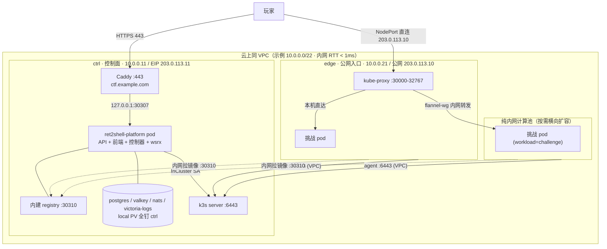

import { Aside } from '@astrojs/starlight/components';

Ret2Shell 由两部分组成：**平台主服务**（Web API + 前端 + 集群控制器）与**承载题目容器的 Kubernetes 集群**。两者可以同装于一个 k3s 集群（推荐生产形态），也可以分离部署。

## 1. 角色分层（典型生产拓扑）

下表是一套经过实战验证的腾讯云同 VPC 三节点拓扑（本文档全部使用示例 IP：控制面 `10.0.0.11` / EIP `203.0.113.11`，入口 `10.0.0.21` / 公网 `203.0.113.10`，计算 `10.0.0.31`）：

| 角色 | 承载内容 | 示例节点 |
| --- | --- | --- |
| **控制面节点** | k3s server（apiserver + sqlite）+ 平台六件套 + 全部 local PV + 宿主机反向代理（Caddy/Nginx） | `ctrl`（10.0.0.11），无 `workload` 标签，不跑题目 |
| **公网入口节点** | k3s agent，`ret.sh.cn/role=ingress`；承载 NodePort 公网入口转发与 SSH 跳板带宽 | `edge`（10.0.0.21），无 `workload` 标签 |
| **纯内网计算节点** | k3s agent，`ret.sh.cn/workload=challenge`；只与 VPC 内网互通，公网出入全封闭 | `node1` 及模板克隆节点 `node-*` |



## 2. 平台组件（Helm Chart 六件套）

| 组件 | 作用 | 持久化 |
| --- | --- | --- |
| `ret2shell-platform` | `r2s-server`：Web API + 前端静态资源 + 集群控制器 + wsrx 中转 | `platform` PVC（默认 420Gi，按需缩配） |
| `postgresql` (18) | 题库、比赛、用户与提交记录 | `postgresql` PVC |
| `valkey` | Session (24h)、token 黑名单 (7d)、限流 (5min)、实例 60s 启动锁 | `valkey` PVC |
| `nats` (JetStream) | 事件与异步任务队列：`game.{id}.event`、`instance.{id}.status`、`system.task.*` | `nats` PVC |
| `registry` | 内建题目镜像仓库（Distribution HTTP API v2，默认 NodePort `30310`） | `registry` PVC |
| `victoria-logs` | 容器与平台日志聚合 | `victoriaLogs` PVC |

平台访问各依赖组件的地址由 chart 自动渲染为集群内 Service（如 `ret2shell-registry:5000`），见 [Helm values 参考](/config/helm-values/)。

## 3. 平台连接 Kubernetes 的方式

`crates/config/src/cluster.rs` 定义了三级配置回退，由 `crates/cluster/src/lib.rs` 的 `initialize()` 执行：

```toml
[cluster]
enabled = true          # 总开关；false 时平台不接管任何挑战容器
try_default = true      # ① 使用 InCluster ServiceAccount（平台自身跑在 k8s 内时）
auto_infer = false      # ② 推断本机默认 kubeconfig（try_default=false 时生效）
kube_config_path = "…"  # ③ 显式指定 kubeconfig 路径（前两者均为 false 时必填）
```

生产推荐平台 Pod 直接运行在 k3s 内：启用 `try_default = true`，并通过 chart 配置 `rbac.useClusterAdmin: true` 获取集群管理权限。初始化时平台会自动创建 `ret2shell-challenge` 命名空间及默认的 `internet-disabled` NetworkPolicy。

<Aside type="important">
命名空间与单实例硬约束：

- Helm chart 强制安装进 `ret2shell-platform`（`templates/_helpers.tpl` 使用 `{{ fail }}` 拦截其他 namespace）。
- 挑战实例固定创建在 `ret2shell-challenge`（`crates/cluster/src/manager.rs` 的 `CHALLENGE_NS`）。
- 平台主服务为 singleton（`values.schema.json` 中 `replicaCount` 固定为 `const: 1`）。

</Aside>

## 4. 平台与集群的三条内网链路

集群正常运转依赖三条链路（同 VPC 内网延迟通常 < 1ms）：

1. **平台 → apiserver（`10.0.0.11:6443`）**：通过 InCluster ServiceAccount 创建/销毁 Pod 与 Service。
2. **节点间 overlay 网络（UDP `51820`）**：`flannel wireguard-native`（物理 MTU 1500，隧道 MTU 1420）。
3. **apiserver → kubelet（TCP `10250`）**：用于 `kubectl exec/logs` 以及平台 wsrx 的 `port-forward`。

## 5. 玩家访问挑战实例的两条路径

两条路径可同时存在：

- **直连路径（NodePort）**：当全局或比赛配置了 [traffic 脚本](/architecture/traffic-topologies/)时，实例创建为 `NodePort` 类型的 Service，并调用脚本 `expose(node, service)` 将 `(节点名, node_port)` 映射为玩家可见的公网地址。
- **中转路径（wsrx）**：前端内置 wsrx 客户端或本地 wsrx CLI 连接 `wss://<域名>/api/traffic/{traffic_token}?port=N`，平台后端按标签 `ret.sh.cn/traffic=<token>` 定位 Pod 并通过 kube `port-forward` 双向转发流数据。未配置任何 traffic 脚本时这是唯一路径（Service 为 `ClusterIP`），详见[实时通信与流量隧道](/api/realtime/)。

## 6. 容灾与横向扩展

- **控制面**：平台 Pod 单副本，k3s 使用单机 sqlite。控制面短暂重启期间只是无法开启新实例，**计算节点上已运行的挑战容器不受影响**。
- **计算面**：所有打了 `ret.sh.cn/workload=challenge` 标签的节点共同组成无状态计算池。节点维护用 `kubectl cordon` 平滑排空；由于动态 flag 按用户与题目确定性生成，玩家重开实例后 flag 不变。
- 扩容与节点上下线的标准操作见[调度与扩容 Playbook](/deploy/scaling/)。
