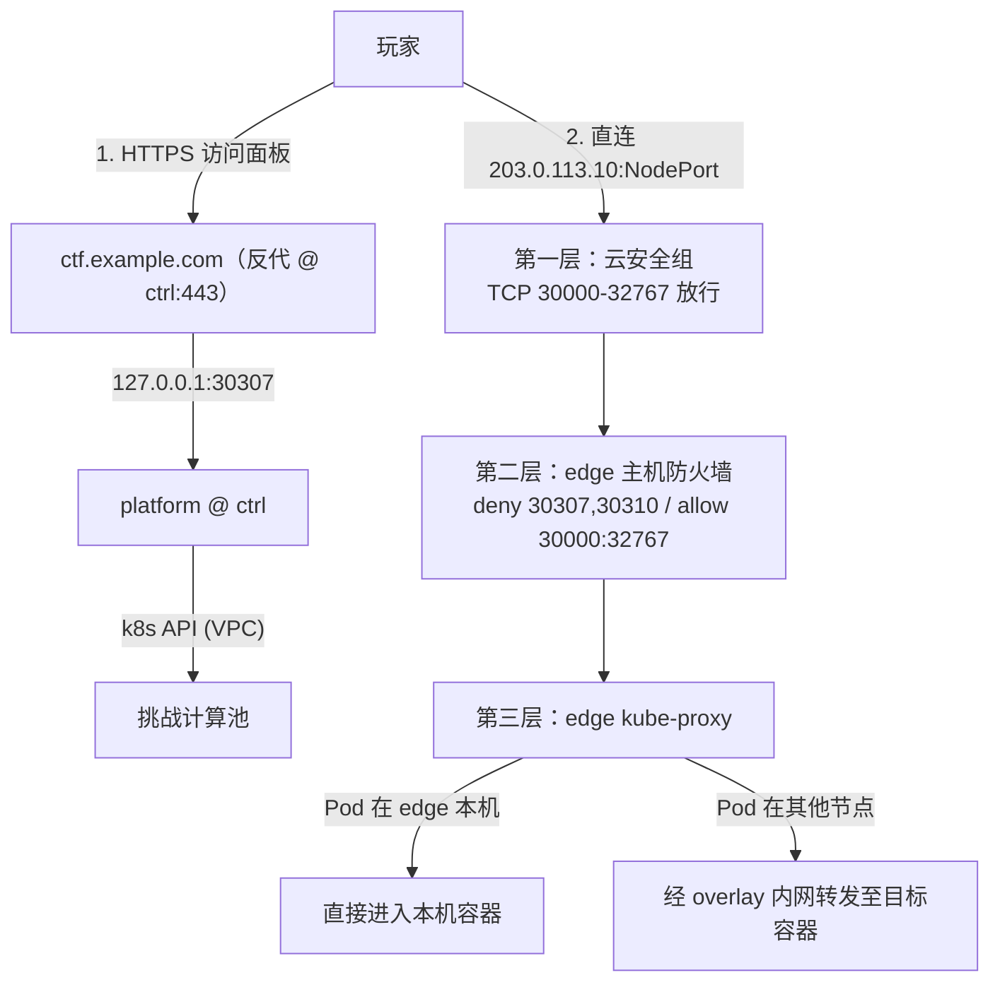

import { Aside } from '@astrojs/starlight/components';

挑战实例的出口由 Rune 脚本 `expose(node, service)` 动态映射（`crates/cluster/src/traffic.rs`）。单出口直连、多节点各自暴露、对接外部 FRP 控制器，本质都是对同一个钩子编写不同脚本；不配置脚本则回退到平台自带的 wsrx WebSocket 零暴露中转。

## 1. Traffic 脚本契约

```rust
pub async fn expose(node, service)
// node: String —— Pod 实际调度的 k8s 节点名（pod.spec.node_name）
// service: #{
//   traffic: String,       // 21 位 nanoid
//   created_at: u64,       // Unix 时间戳（秒）
//   lifetime: u64,         // 有效时长 = (renew + 1) * 3600
//   ports: Vec<#{
//     name: String,
//     node_port: u16,
//     protocol: "TCP" | "UDP" | "STCP",
//     app_protocol: "raw" | "http"
//   }>
// }
// 返回值: Ok(#{ 端口名: "对外地址:端口" })
```

**运行约束**：

1. **幂等性**：玩家请求实例信息时都会触发脚本（平台有缓存但仍可能重复）；脚本内调用外部控制器 API 时，控制器必须按 `service.traffic` 幂等去重。
2. **无销毁回调**：平台销毁实例**不会**回调 traffic 脚本清理外部资源，外部控制器需按 `created_at + lifetime` 自行 TTL 回收。
3. **可用模块**：Rune 运行时开放 `http`、`json`、`toml`、`rand`、`process`（`traffic.rs`）。
4. **配置入口**：`PATCH /api/cluster/traffic`（全局）或 `/api/game/{id}/traffic`（单场）；`config.toml` 的 `traffic` 字段已废弃。面板内置 `single-node-direct` 与 `multi-node-direct` 两个预设模板。

<Aside type="note">
**NodePort 全集群监听**：k8s Service 的 NodePort 默认 `externalTrafficPolicy: Cluster`——集群内**任意**节点的 `IP:nodePort` 都能访问该实例。流量到达入口节点后由 kube-proxy DNAT 并经 overlay 内网转发至目标 Pod。这正是「一台大带宽公网节点为所有无公网计算节点统一做入口」的底层前提。
</Aside>

## 2. 拓扑 A · 单一出口节点（推荐）

**适用**：云上同 VPC 内开多台低成本计算节点（无需大公网带宽），统一复用入口节点 `edge`（示例公网 `203.0.113.10`）作为玩家访问入口。

内置预设脚本 `single_node_direct.rx`：

```rust
const PUBLIC_ENTRY = "203.0.113.10";
pub async fn expose(node, service) {
    let result = #{};
    for port in service.ports {
        result[port.name] = `${PUBLIC_ENTRY}:${port.node_port}`;
    }
    Ok(result)
}
```

- 脚本忽略 `node` 参数，恒返回入口机公网地址。
- Pod 落在 `edge` 本机则直接进容器；落在其他计算节点则由 `edge` 的 kube-proxy 经内网隧道毫秒级转发，玩家无感知。
- 防火墙：只需入口节点对公网放行 NodePort 段（并在顶部 deny 平台端口 `30307`/`30310`），其余节点仅需 VPC 内网互通。

## 3. 拓扑 B · 多出口节点

**适用**：多台计算节点各有独立大带宽公网 IP，分散入口压力。

内置预设脚本 `multi_node_direct.rx`：

```rust
const PUBLIC_ENTRIES = #{
    "edge-1": "203.0.113.10",
    "edge-2": "203.0.113.20",
};
pub async fn expose(node, service) {
    let result = #{};
    let ip = PUBLIC_ENTRIES.get(node)?;   // 按 Pod 实际所在节点查表
    for port in service.ports {
        result[port.name] = `${ip}:${port.node_port}`;
    }
    Ok(result)
}
```

- 每个计算节点都要在安全组与主机防火墙放行 NodePort 段（并同样拦截 `30307,30310`）。
- 新节点未加进查表时，可把 `.get(node)?` 改写为 `.get(node).unwrap_or("203.0.113.10")`——有独立公网的走自己，没有的自动回退走入口机转发。

## 4. 拓扑 C · 外部控制器（FRP / 动态反向隧道）

**适用**：所有节点都在纯内网/NAT 后，通过外部公网中转服务动态映射端口。

```rust
pub async fn expose(node, service) {
    let result = #{};
    for port in service.ports {
        let resp = http::post("https://frp.example.com/api/map", #{
            id: service.traffic,
            node: node,
            port: port.node_port,
            expire: service.created_at + service.lifetime,
        }).await?;
        result[port.name] = resp.address;
    }
    Ok(result)
}
```

## 5. 拓扑 D · 零暴露中转（wsrx）

**适用**：高安全隔离赛、纯 TCP 题目环境。

- **配置**：清空全局与比赛级 traffic 脚本 → `need_expose = false` → Service 自动建为 `ClusterIP`。
- **流量路径**：

  ```text
  玩家浏览器 / wsrx CLI ──wss://ctf.example.com/api/traffic/{token}?port=N──> 平台 Pod ──kube port-forward──> 挑战 Pod:N
  ```

- **优缺点**：计算节点完全零公网端口暴露，仅需平台 443 可达；代价是所有实例流量经平台节点中转（受限于控制面带宽），且不支持 UDP 题目。

## 6. 四种拓扑横向对比

| 维度 | A 单出口 | B 多出口 | C 外部控制器 | D wsrx 中转 |
| --- | --- | --- | --- | --- |
| **计算节点需开公网端口** | 仅入口节点 | 全部计算节点 | 不需要 | 不需要 |
| **带宽上限** | 入口节点带宽 | 各节点带宽之和 | 控制器入口带宽 | 控制面带宽 |
| **UDP 题目支持** | 支持 | 支持 | 视控制器实现 | 不支持（仅 TCP 流） |
| **Traffic 脚本** | `single-node-direct` | `multi-node-direct` | 自写 HTTP 调用 | 留空不配 |
| **玩家连接方式** | `公网IP:nodePort` | `节点IP:nodePort` | 控制器返回地址 | 本机 `127.0.0.1:随机端口` |

## 7. 入口连通性排障：三层防火墙分层判丢

生产出口链路的防火墙分层（以拓扑 A 为例）：



玩家连不上 `<入口IP>:<nodePort>` 时，在入口机抓包并从外部发起连接：

```bash
sudo tcpdump -ni eth0 "tcp port <nodePort>"
```

- **外部发包但抓不到任何 `SYN`**：被第一层（云安全组）拦截。
- **抓到 `SYN` 到达 `eth0` 但无 `SYN-ACK` 回包**：被第二层（主机防火墙）丢弃，或跨节点转发被 FORWARD 链丢弃（确认放行了 `flannel-wg`/`cni0` 的 route 转发）。
