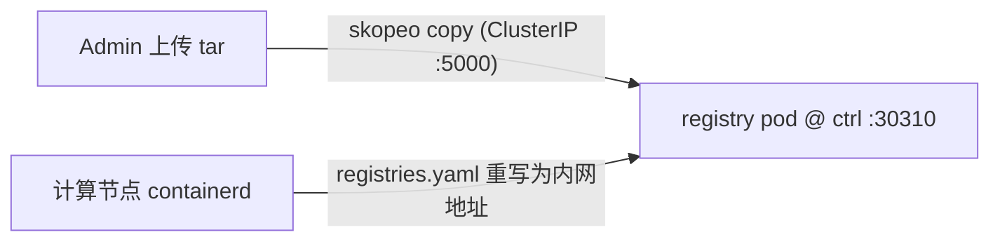

import { Aside } from '@astrojs/starlight/components';

## 1. 镜像上传链路（平台内建）

源码位置：`crates/cluster/src/registry.rs` 的 `upload_image`。

- **支持格式**：`.tar` / `.tar.gz` / `.tgz` / `.tar.zst`（`docker save` 导出包），上传后暂存于 `/tmp/ret2shell`。
- **推送实现**：调用外部命令 **skopeo**：

  ```bash
  skopeo copy docker-archive:<file> docker://<user>:<pass>@<server>/<org>/<repo>:latest
  ```

  配置 `insecure = true` 时自动追加 `--dest-tls-verify=false`。

<Aside type="important">
平台运行环境必须包含 `skopeo`。官方容器镜像已内置；二进制直跑部署需确保宿主机 `PATH` 中安装了 skopeo。
</Aside>

### 配置结构

参数来自 `[cluster.registry]`（`crates/config/src/cluster.rs` 的 `RegistryConfig`）：

```toml
[cluster.registry]
enabled  = true
server   = "ret2shell-registry:5000"     # 平台在集群内部推送镜像的地址
external = "203.0.113.11:30310"          # 写入镜像 tag 前缀的仓库地址（对外可达）
insecure = true                          # HTTP 无 TLS
username = "…"                           # 可选
password = "…"
```

对应 Helm values（渲染进 config.toml）：

```yaml
registry:
  externalAccess:
    enabled: true
    serviceType: NodePort
    nodePort: 30310
    host: 203.0.113.11:30310   # 渲染为 external 字段
    insecure: true
```

## 2. 仓库管理与 API 代理

- 平台在 `/api/cluster/registry/{*}` 全量代理内建 registry 的 HTTP API v2（需 DevOps 权限）。
- 常用查询：`GET /v2/_catalog`（列出仓库）、`GET /v2/<name>/tags/list`（列出标签）。
- 面板集成：`registry.mode: internal` 时可在 Admin 面板直接搜索已上传镜像；启用内建仓库后不支持混用外部 registry 搜索。

## 3. 节点侧拉取链路（内网秒拉）

计算节点拉取镜像时按题目配置的**完整镜像引用**解析（如 `203.0.113.11:30310/challenge/pwn-xx:latest`）。各计算节点的 `/etc/rancher/k3s/registries.yaml` 把该地址重定向到 VPC 内网：



```yaml
mirrors:
  docker.io:
    endpoint:
      - "https://mirror.ccs.tencentyun.com"
  "203.0.113.11:30310":
    endpoint:
      - "http://10.0.0.11:30310"
  "10.0.0.11:30310":
    endpoint:
      - "http://10.0.0.11:30310"
```

**优势**：

1. **秒级拉取**：即使平台强制 `imagePullPolicy: Always`，digest 校验与层拉取均走内网链路，不占控制面公网带宽。
2. **安全隔离**：`30310` 无需对公网开放；入口节点防火墙已显式 deny（[坑 16](/ops/troubleshooting/坑-16--nodeport-全区间放行导致-3030730310-裸露安全审计修复)），防止选手从 NodePort 段夹带拖走题目镜像。

## 4. 外部私有仓库与 pull_secret

不使用内建 registry、直接引用外部私有仓库（GHCR / 云厂商 TCR 等）时：

- 在题目配置 `ChallengeEnv.pull_secret` 填入 Kubernetes Secret 名称，平台注入挑战 Pod 的 `imagePullSecrets`（`manager.rs`）。
- <Aside type="caution">该 Secret 必须创建在 **`ret2shell-challenge`** 命名空间下（不是 `ret2shell-platform`）。</Aside>

## 5. 不同部署形态的 Registry 配置对照

| 部署形态 | 配置方式 |
| --- | --- |
| **Helm（内建 registry，推荐）** | Chart 自动渲染 `[cluster.registry]`，`server=ret2shell-registry:5000`；计算节点经内网 `:30310` 拉取 |
| **外部镜像仓库** | 关闭内建 registry；题目镜像 `tag` 直接填外部完整地址，按需配 `pull_secret` |
| **Compose / Standalone** | `try_default=false, auto_infer=false, kube_config_path=...` 配合外部 k8s 集群 |

## 6. 存储与扩容

- 内建 registry 存储绑定 `registry` PVC（默认 300Gi，local PV 模式下实际受宿主机磁盘余量限制；告警时同步调大 PV 容量与磁盘）。
- 升级 chart 时务必确认 PostgreSQL 挂载点补丁已重新应用（[坑 5](/ops/troubleshooting/坑-5--postgresql-18-镜像拒绝旧挂载点)）。
