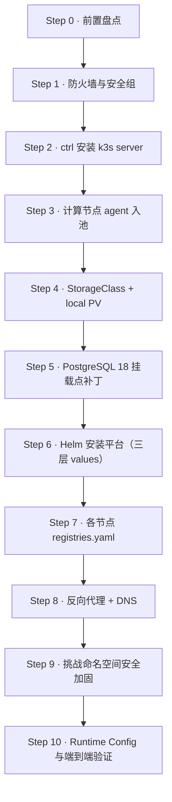

import { Steps } from '@astrojs/starlight/components';
import { Aside } from '@astrojs/starlight/components';

本指南按部署顺序整理从零搭建整套平台的命令、安全加固与验证标准（Step 0 → 10）。示例环境为云厂商同 VPC 三节点内网直连拓扑（控制面 `ctrl` = 10.0.0.11 / EIP 203.0.113.11，入口 `edge` = 10.0.0.21 / 公网 203.0.113.10，计算 `node1` = 10.0.0.31），请替换为你自己的值。

软件版本：ret2shell v3.10.11 · k3s v1.36.4+k3s1 · Helm 4.x · Caddy。

## 部署路线图



<Steps>

### Step 0 · 前置盘点

- **机器规划**（同 VPC `10.0.0.0/22`）：
  - `ctrl`：承载 k3s server、平台六件套与宿主机反向代理（示例 2C/4G/40G）。
  - `edge`：承载 NodePort 公网入口（大带宽）与 SSH 跳板。
  - 计算节点（`node1` 及克隆）：纯内网即可，无需公网带宽。
- **本地准备部署目录**（如 `~/r2s-deploy/`）：三层 values（`values-common.yaml` / `values-exposure.yaml` / `values.private.yaml`）、`storage-local.yaml`、节点 `registries.yaml`、chart 补丁。

### Step 1 · 防火墙与安全组

**云安全组（控制台）**：

| 节点 | 方向 | 端口 | 来源 | 用途 |
| --- | --- | --- | --- | --- |
| ctrl | 入站 | TCP `80/443/22` | `0.0.0.0/0` | 面板 HTTPS、SSH 管理 |
| 全部节点 | 双向 | 全部端口（或 `6443,10250,30310,30000-32767` + UDP `51820`） | VPC 网段 | 控制面、kubelet、镜像拉取、WireGuard |
| edge | 入站 | TCP `30000-32767` | `0.0.0.0/0` | 玩家直连挑战 NodePort |

**入口节点主机防火墙（ufw）**——k8s NodePort 在**所有节点**均监听，必须显式拦截平台端口与 registry 端口的公网访问：

```bash
# 1. 顶部拦截公网访问 30307（平台 HTTP）与 30310（无鉴权内建 registry）
sudo ufw insert 1 deny in on eth0 to any port 30307,30310 proto tcp

# 2. 放行挑战 NodePort 段与 VPC 内网互访
sudo ufw allow 30000:32767/tcp
sudo ufw allow from 10.0.0.0/22

# 3. 放行跨节点 Pod 流量转发（ufw 默认 FORWARD DROP）
sudo ufw route allow in on flannel-wg && sudo ufw route allow out on flannel-wg
sudo ufw route allow in on cni0 && sudo ufw route allow out on cni0
```

### Step 2 · ctrl 安装 k3s server

```bash
curl -sfL https://get.k3s.io | INSTALL_K3S_VERSION=v1.36.4%2Bk3s1 sh -s - server \
  --node-ip=10.0.0.11 \
  --tls-san=203.0.113.11 \
  --flannel-backend=wireguard-native \
  --disable=traefik --disable=servicelb --disable=metrics-server \
  --write-kubeconfig-mode=600
```

<Aside type="caution">
**用 `--tls-san=<EIP>`，不要用 `--node-external-ip=<EIP>`。** 后者会让 apiserver 把公网 IP 下发给所有 agent 作为 remotedialer 隧道地址——纯内网计算节点连不上公网 IP，会导致 `kubectl exec/logs` 报 502（详见[踩坑手册 · 坑 19](/ops/troubleshooting/坑-19--纯内网节点的-kubectl-execlogs-502--node-external-ip-诱导与主机名大小写)）。
</Aside>

**验证**：`k3s kubectl get nodes -o wide` 显示 `ctrl` 的 INTERNAL-IP 为 `10.0.0.11` 且 `Ready`。

### Step 3 · 计算节点安装 agent 入池

从 ctrl 获取 Token：`cat /var/lib/rancher/k3s/server/node-token`。

```bash
# 入口节点 edge（带公网 IP，声明 node-external-ip 供 NodePort 宣告）
curl -sfL https://get.k3s.io | K3S_URL=https://10.0.0.11:6443 K3S_TOKEN=<token> \
  INSTALL_K3S_VERSION=v1.36.4%2Bk3s1 sh -s - agent \
  --node-ip=10.0.0.21 \
  --node-external-ip=203.0.113.10 \
  --kubelet-arg=fail-swap-on=false

# 纯内网计算节点 node1（不开公网，只填内网 IP）
curl -sfL https://get.k3s.io | K3S_URL=https://10.0.0.11:6443 K3S_TOKEN=<token> \
  INSTALL_K3S_VERSION=v1.36.4%2Bk3s1 sh -s - agent \
  --node-ip=10.0.0.31 \
  --node-label="ret.sh.cn/workload=challenge" \
  --kubelet-arg=fail-swap-on=false

# 在 ctrl 上给入口节点打角色标签
k3s kubectl label node edge ret.sh.cn/workload=challenge ret.sh.cn/role=ingress
```

<Aside type="note">
主机名必须是**纯小写**：k8s Node 对象名强制小写，主机名若含大写（云厂商默认主机名常见）会引发证书/会话标识不一致。先 `hostnamectl set-hostname $(hostname | tr '[:upper:]' '[:lower:]')`。
</Aside>

**验证**：ctrl 上 `wg show flannel-wg` 确认各 peer 握手成功；`ping` 对端 Pod 网关延迟 < 1ms。

### Step 4 · StorageClass + local PV

平台六个有状态组件均使用 `no-provisioner + WaitForFirstConsumer + Retain` 的 StorageClass，通过手工 local PV 将 `nodeAffinity` 固定在 ctrl。参考 `deploy/k8s/storage-local.yaml`：

```bash
ssh ctrl 'mkdir -p /srv/ret2shell/backend/storage/{platform,database,cache,queue,registry,logs}-pv1'
KUBECONFIG=/etc/rancher/k3s/k3s.yaml kubectl apply -f storage-local.yaml
```

**验证**：`kubectl get sc,pv` 确认 6 组 SC 与 PV 均为 `Available`。

### Step 5 · PostgreSQL 18 挂载点补丁

<Aside type="caution">
**不打补丁 PostgreSQL 无限 CrashLoop。** 上游 chart 模板硬编码 `mountPath: /var/lib/postgresql/data`，而 PostgreSQL 18+ 官方镜像要求挂载到父目录 `/var/lib/postgresql`（数据存版本化子目录 `18/docker`）。
</Aside>

```bash
# 用本地补丁覆盖 chart 副本中的模板（每次升级 chart 后都要重打！）
cp chart-patch/postgresql.yaml ~/r2s-deploy/templates/postgresql.yaml
```

### Step 6 · Helm 安装平台（三层 values）

```bash
kubectl create namespace ret2shell-platform    # Chart 强制校验该名称
cd ~/r2s-deploy
KUBECONFIG=/etc/rancher/k3s/k3s.yaml helm upgrade --install ret2shell . -n ret2shell-platform \
  -f values-common.yaml -f values-exposure.yaml -f values.private.yaml
```

values 分层职责与关键字段见 [Helm values 参考](/config/helm-values/)。**注意 `platform.config.cluster.nodeSelector` 只填标签值 `"challenge"`**（[坑 13](/ops/troubleshooting/坑-13--node-selector-要填标签值不是键值对)）。

**验证**：`kubectl -n ret2shell-platform get pods` 六个 Pod 全部 `Running`。

### Step 7 · 各节点 registries.yaml（内网秒拉）

计算节点通过 VPC 内网拉取 ctrl 上的内建 registry，不占公网带宽：

```yaml
# edge 与所有计算节点的 /etc/rancher/k3s/registries.yaml
mirrors:
  docker.io:
    endpoint:
      - "https://mirror.ccs.tencentyun.com"   # 按云厂商替换
  "203.0.113.11:30310":
    endpoint:
      - "http://10.0.0.11:30310"              # 重定向到 VPC 内网
  "10.0.0.11:30310":
    endpoint:
      - "http://10.0.0.11:30310"
```

修改后重启 `k3s-agent`。详见[题目镜像与 Registry](/deploy/challenge-images/)。

### Step 8 · 反向代理 + DNS

以 Caddy 为例（`/etc/caddy/Caddyfile`）：

```
ctf.example.com {
	reverse_proxy 127.0.0.1:30307
}
```

`systemctl reload caddy` 后 `curl -I https://ctf.example.com` 返回 200。

### Step 9 · 挑战命名空间安全加固（必做）

平台初始化后会自动创建 `ret2shell-challenge` 命名空间与 `internet-disabled` 策略。额外两项加固防止选手从题目容器横向渗透集群或内网，完整说明见[安全加固清单](/deploy/security-hardening/)：

```bash
# 1. 禁用挑战 Pod 默认挂载 ServiceAccount Token
k3s kubectl -n ret2shell-challenge patch serviceaccount default \
  -p '{"automountServiceAccountToken": false}'

# 2. 阻断题目容器探测私网与云 metadata
k3s kubectl apply -f - << 'EOF'
apiVersion: networking.k8s.io/v1
kind: NetworkPolicy
metadata:
  name: deny-internal-networks
  namespace: ret2shell-challenge
spec:
  podSelector: {}
  policyTypes:
    - Egress
  egress:
    - ports:
        - protocol: UDP
          port: 53
        - protocol: TCP
          port: 53
    - to:
        - ipBlock:
            cidr: 0.0.0.0/0
            except:
              - 10.0.0.0/8
              - 172.16.0.0/12
              - 192.168.0.0/16
              - 169.254.0.0/16
EOF
```

### Step 10 · Runtime Config 与端到端验证

1. **Admin 面板配置**：`nodeSelector` 填 `challenge`；traffic 脚本选 `single-node-direct` 模板，`PUBLIC_ENTRY` 设为入口节点公网 IP（示例 `203.0.113.10`）。
2. **全链路冒烟**：

   ```bash
   # 在挑战命名空间启动测试容器并暴露 NodePort
   k3s kubectl -n ret2shell-challenge run t1 \
     --image=203.0.113.11:30310/challenge/php-http-example:latest --port=80 --expose
   k3s kubectl -n ret2shell-challenge patch svc t1 -p '{"spec":{"type":"NodePort"}}'
   NP=$(k3s kubectl -n ret2shell-challenge get svc t1 -o jsonpath='{.spec.ports[0].nodePort}')

   # 验证公网经入口节点访问返回 200
   curl -I http://203.0.113.10:$NP/

   # 清理测试资源
   k3s kubectl -n ret2shell-challenge delete pod,svc t1 --force --grace-period=0
   ```

</Steps>

## 升级

```bash
cd ~/r2s-deploy
# 1. 同步上游 helm chart；若 chart 模板有更新，必须重打 postgres 18 挂载点补丁（Step 5）
# 2. 更新 values.private.yaml 的 image.tag 与 Chart.yaml 的 version/appVersion
KUBECONFIG=/etc/rancher/k3s/k3s.yaml helm upgrade ret2shell . -n ret2shell-platform \
  -f values-common.yaml -f values-exposure.yaml -f values.private.yaml
```

## 赛前备份

```bash
# 开赛前备份 PostgreSQL（PV 位于 ctrl 的 /srv/ret2shell/backend/storage/database-pv1）
ssh ctrl 'k3s kubectl -n ret2shell-platform exec ret2shell-postgresql-0 -- pg_dumpall -U postgres' \
  > backup-$(date +%F).sql
```
