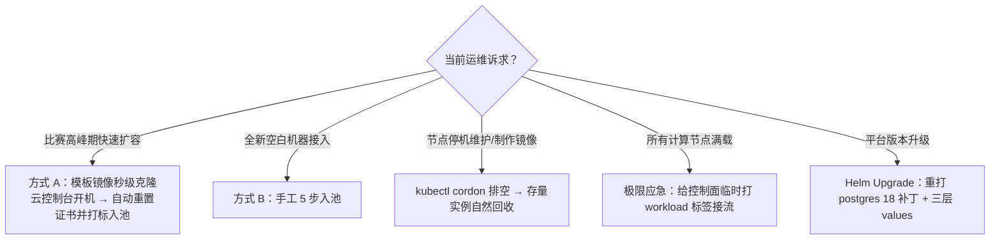

import { Steps } from '@astrojs/starlight/components';
import { Aside } from '@astrojs/starlight/components';

## 0. 扩容与维护决策路径



## 1. 方式 A：模板镜像快速扩容（推荐）

把一台标准计算节点固化为云自定义镜像，之后克隆出的新机器**开机即自动入池**。前提是母机上装有自举脚本 `/usr/local/bin/k3s-agent-bootstrap.sh`：

```bash
#!/usr/bin/env bash
set -euo pipefail

# 1. 自动获取 eth0 主内网 IPv4
NODE_IP=$(ip -4 -o addr show dev eth0 | awk '{print $4}' | cut -d/ -f1 | head -n1)
if [ -z "$NODE_IP" ]; then
    echo "ERROR: No IPv4 address found on eth0" >&2
    exit 1
fi

# 2. 强制小写主机名（云厂商默认大写会导致 remotedialer 会话名不匹配）
CURRENT_HOST=$(hostname)
LOWER_HOST=$(echo "$CURRENT_HOST" | tr '[:upper:]' '[:lower:]')
if [ "$CURRENT_HOST" != "$LOWER_HOST" ]; then
    hostnamectl set-hostname "$LOWER_HOST"
    sed -i "s/$CURRENT_HOST/$LOWER_HOST/g" /etc/hosts || true
fi

# 3. 检测克隆机（eth0 IP 与上次记录不同 → 重置节点身份）
STATE_FILE="/var/lib/rancher/k3s/agent/.template-node-ip"
mkdir -p /var/lib/rancher/k3s/agent
if [ -f "$STATE_FILE" ]; then
    LAST_IP=$(cat "$STATE_FILE")
    if [ "$LAST_IP" != "$NODE_IP" ]; then
        echo "Detected cloned VM (IP changed from $LAST_IP to $NODE_IP). Resetting k3s node identity..."
        rm -rf /etc/rancher/node
        rm -f /var/lib/rancher/k3s/agent/*.crt /var/lib/rancher/k3s/agent/*.key /var/lib/rancher/k3s/agent/*.kubeconfig
        rm -rf /var/lib/cni/networks/* /var/lib/kubelet/pki/*
        ip link delete flannel-wg 2>/dev/null || true
    fi
fi
echo "$NODE_IP" > "$STATE_FILE"

# 4. 启动 k3s agent，自动携带挑战池标签入池
exec /usr/local/bin/k3s agent \
    --node-ip="$NODE_IP" \
    --node-name="$LOWER_HOST" \
    --node-label="ret.sh.cn/workload=challenge" \
    --kubelet-arg="fail-swap-on=false"
```

<Steps>

### 制作模板镜像

在云控制台对母机直接「制作自定义镜像」——**无需**手工删除证书或停止服务：克隆机开机自举时对比 `eth0` IP 与 `.template-node-ip`，发现 IP 变化自动清理旧证书与 flannel-wg。

### 从模板批量创建计算节点

1. 用自定义镜像新建按量计费实例。
2. 放入已与控制面 VPC 打通内网路由的子网；**无需购买公网 IP**。
3. 开机约 15 秒内自动完成入池：规范化小写主机名 → 清空旧证书 → 以新内网 IP 注册并携带 `ret.sh.cn/workload=challenge` 标签。
4. 控制面验证：

   ```bash
   k3s kubectl get nodes -o wide --show-labels
   ```

### 赛后退池

```bash
k3s kubectl cordon <节点名> && k3s kubectl delete node <节点名>
# 然后在云控制台退还销毁按量计费实例
```

</Steps>

## 2. 方式 B：全新 Debian 机器手工入池（5 步 SOP）

```bash
# 1. 在 ctrl 获取集群 token
cat /var/lib/rancher/k3s/server/node-token

# 2. 写入 registries.yaml（内网秒拉镜像）
mkdir -p /etc/rancher/k3s
cat << 'EOF' > /etc/rancher/k3s/registries.yaml
mirrors:
  docker.io:
    endpoint:
      - "https://mirror.ccs.tencentyun.com"
  "203.0.113.11:30310":
    endpoint:
      - "http://10.0.0.11:30310"
  "10.0.0.11:30310":
    endpoint:
      - "http://10.0.0.11:30310"
EOF

# 3. 规范化小写主机名（防 remotedialer 502）
hostnamectl set-hostname "$(hostname | tr '[:upper:]' '[:lower:]')"

# 4. 配置防火墙（纯内网计算节点参照安全加固清单的 raw PREROUTING + ufw 白名单）

# 5. 启动 k3s-agent（自动打标入池）
k3s agent \
  --server https://10.0.0.11:6443 \
  --token '<TOKEN>' \
  --node-ip="$(ip -4 -o addr show dev eth0 | awk '{print $4}' | cut -d/ -f1 | head -n1)" \
  --node-label="ret.sh.cn/workload=challenge" \
  --kubelet-arg="fail-swap-on=false"
```

## 3. 单公网入口下的节点维护

采用 `single-node-direct` traffic 脚本时，无论 Pod 调度到哪台计算节点，玩家统一连入口机公网地址，入口机 kube-proxy 经内网隧道自动转发。因此：

```bash
# 冻结节点：新实例分流到池内其他节点，已运行实例继续存活至 TTL 结束
k3s kubectl cordon <节点名>
# 维护完成后恢复
k3s kubectl uncordon <节点名>
```

## 4. 调试期 vs 正式上线：收放节点跑题权限

- **调试期**：控制面、入口节点、计算节点都可以打上 `workload=challenge` 共同分担题目实例（即便计算节点关机或拿去做镜像，平台依然能开题测试）：

  ```bash
  k3s kubectl label node ctrl edge ret.sh.cn/workload=challenge --overwrite
  ```

- **正式比赛上线前**：剥离控制面（保护数据库与平台内存）与入口节点（保障公网转发与跳板稳定）的跑题权限，题目容器 100% 只调度到纯内网计算池：

  ```bash
  # 末尾减号移除标签，秒级生效；仅影响新开实例，已运行实例存活至 TTL 结束
  k3s kubectl label node ctrl edge ret.sh.cn/workload-
  ```

## 5. 平台版本升级

```bash
cd ~/r2s-deploy
# 1. 同步上游 chart；若 chart 模板更新，重打 postgres 18 挂载点补丁
cp chart-patch/postgresql.yaml templates/postgresql.yaml
# 2. 更新 values.private.yaml 的 image.tag 与 Chart.yaml 的 version/appVersion
KUBECONFIG=/etc/rancher/k3s/k3s.yaml helm upgrade ret2shell . -n ret2shell-platform \
  -f values-common.yaml -f values-exposure.yaml -f values.private.yaml
```

## 6. 赛前检查清单

1. **数据库备份**：`pg_dumpall` 导出并异地保存（命令见 [k3s 生产部署 · 赛前备份](/deploy/k3s-production/#赛前备份)）。
2. **安全策略核查**：`ret2shell-challenge` 下存在 `internet-disabled` 与 `deny-internal-networks` 两条 NetworkPolicy，`default` SA 的 `automountServiceAccountToken` 为 `false`：

   ```bash
   k3s kubectl -n ret2shell-challenge get netpol
   k3s kubectl -n ret2shell-challenge get sa default -o yaml | grep automount
   ```

3. **端到端开题验证**：前台开启测试题，验证入口公网 NodePort 访问与动态 flag 提交正常。
4. **收权**：执行第 4 节的上线前收权命令。
