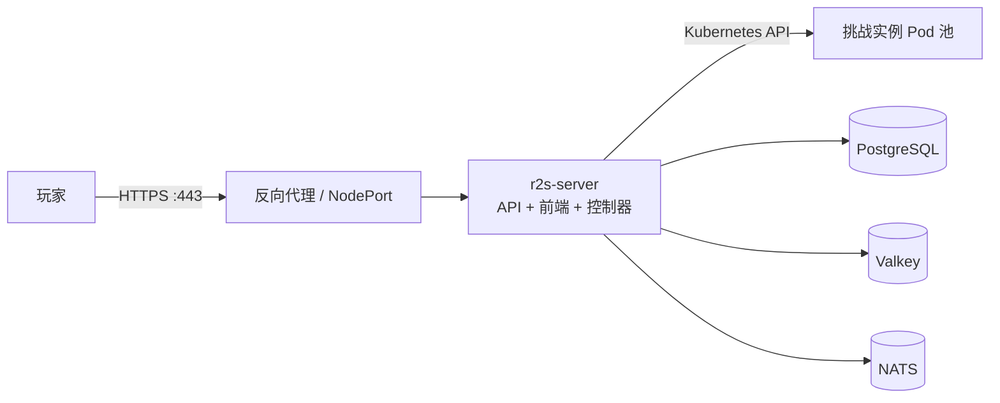

import { Card, CardGrid } from '@astrojs/starlight/components';

**Ret2Shell** 是一个功能丰富的 CTF 竞赛平台，基于 Kubernetes 动态编排题目容器实例，支持团队协作、实时通信与可编程的流量出口设计。本文档覆盖架构原理、生产部署、配置参考与运维排障。

[快速开始](/getting-started/) · [运维速查手册](/ops/cheatsheet/) · [源码仓库](https://github.com/ret2shell/ret2shell)

:::note[版本]
本文档基于 **v3.10.11**（Rust MSRV 1.95.0+，SolidJS 1.9+）编写。
:::

## 核心特性

- **动态容器挑战**：每道题目按需拉起独立 Pod 实例，TTL 自动回收、支持续期，动态 flag 按用户确定性生成。
- **团队协作**：团队组建、邀请、权限分级与实时排行榜。
- **可编程出口**：通过 Rune 脚本 `expose(node, service)` 自定义实例暴露方式（单出口直连、多出口、外部 FRP 控制器、wsrx 零暴露中转）。
- **实时通信**：内置聊天、通知、公告与 WebSocket 推送。
- **安全纵深**：JWT 认证、GCRA 速率限制、敏感词审计、实例级 NetworkPolicy 隔离、PoW 验证码。
- **国际化**：中文 / 英文多语言支持。

## 技术栈

| 层级 | 技术 |
| --- | --- |
| 后端 | Rust (Axum · SeaORM) |
| 数据库 | PostgreSQL 18+ |
| 缓存 | Redis / Valkey 8+ |
| 消息队列 | NATS 2+ (JetStream) |
| 前端 | SolidJS · TypeScript · Vite · Tailwind CSS |
| 部署 | Docker Compose · Kubernetes / Helm · k3s |

## 平台与集群的关系

平台主服务 `r2s-server` 通过 Kubernetes API 管理题目实例：玩家开启挑战时创建 Pod 与 Service，到期自动回收。生产环境推荐平台与集群同装（InCluster 模式），详见[平台与集群架构](/architecture/overview/)。

## 文档导航

<CardGrid stagger>
  <Card title="快速开始" icon="rocket">
    本地开发环境搭建：Docker Compose 依赖 + 前后端热重载。
  </Card>
  <Card title="架构与原理" icon="puzzle">
    平台组件、实例生命周期、网络出口设计。
  </Card>
  <Card title="部署指南" icon="box">
    Docker Compose / Helm / k3s 生产部署与安全加固。
  </Card>
  <Card title="配置参考" icon="setting">
    config.toml 全量字段、Helm values、运行时配置。
  </Card>
  <Card title="API 参考" icon="code">
    REST API 与 WebSocket 流量隧道。
  </Card>
  <Card title="运维手册" icon="wrench">
    速查手册与 19 个实战踩坑的排障方案。
  </Card>
</CardGrid>

## 社区与支持

- QQ 群：[1104642385](https://qm.qq.com/q/u0BUcpU6l2)
- Telegram：[t.me/ret2shell](https://t.me/ret2shell)
- GitHub Discussions：[项目讨论区](https://github.com/ret2shell/ret2shell/discussions)

Ret2Shell 使用 GPL-3.0 衍生的自定义许可证，含用户面向的商业化限制，详见 [LICENSE](https://github.com/ret2shell/ret2shell/blob/main/LICENSE) 与 [COMMERCIAL_POLICY](https://github.com/ret2shell/ret2shell/blob/main/COMMERCIAL_POLICY.md)。
